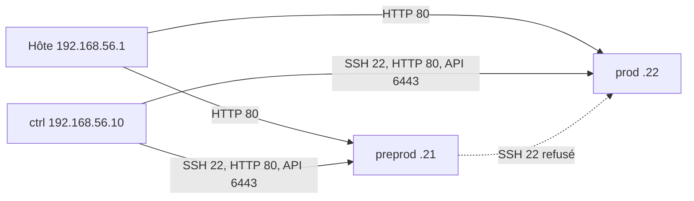

# Architecture du laboratoire

Trois machines VirtualBox, réseau hôte 192.168.56.0/24.

| Machine | IP | Rôle |
| --- | --- | --- |
| ctrl | 192.168.56.10 | Ansible, Vault, clés SSH. Ne fait pas tourner l'application. |
| preprod | 192.168.56.21 | k3s, 1 réplica, sans NetworkPolicy. Comptes alice et bob. |
| prod | 192.168.56.22 | k3s, 2 réplicas, NetworkPolicy. Compte bob seul. |

Flux voulus par ufw : entrant refusé, puis une liste blanche. SSH n'est ouvert que depuis ctrl et le NAT Vagrant. L'API Kubernetes n'est ouverte que depuis ctrl. Le HTTP du smoke test vient de ctrl et de l'hôte.

Limite mesurée au TP14 : depuis la préprod, le port 22 de la prod est fermé, mais le port 80 répond. kube-proxy accepte le service dans `INPUT` avant la chaîne ufw.

Outils : Vagrant décrit les VM, Ansible décrit le socle et pilote Helm, Helm décrit l'application, Goss relit l'état réel.
